<div align="center">

# Redes neuronales paramétricas: *inductive bias* en la búsqueda de una resonancia X → tt̄

### Edición resuelta, extendida y comentada en español de la práctica **PL_02** de ADFM

[](https://colab.research.google.com/github/DanielV-13/ADFM---PL_02_inductive_bias_parameterized_nns.ipynb/blob/main/ADFM_PL_02_inductive_bias_parameterized_nns.ipynb)


**Análisis de Datos en Física Moderna (ADFM)**, Universidad de Oviedo · 2026

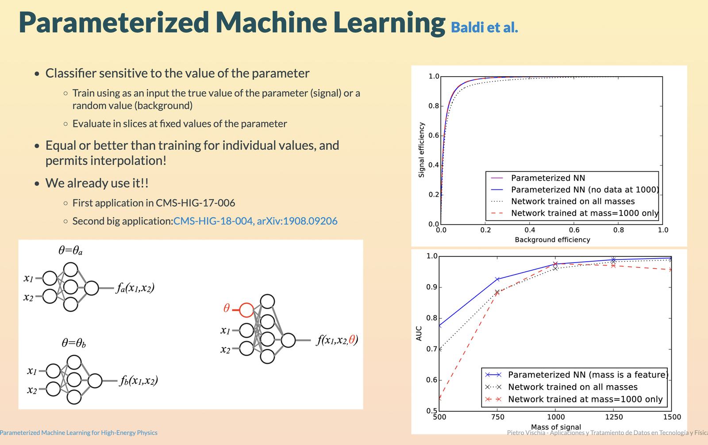

</div>

---

## Tabla de contenidos

1. [Sobre el proyecto](#sobre-el-proyecto)
2. [Contexto físico](#contexto-físico)
3. [La idea central: redes paramétricas e *inductive bias*](#la-idea-central-redes-paramétricas-e-inductive-bias)
4. [Datos y diseño experimental](#datos-y-diseño-experimental)
5. [Implementación](#implementación)
6. [Resultados](#resultados)
7. [Respuestas a las preguntas de la práctica](#respuestas-a-las-preguntas-de-la-práctica)
8. [Conclusiones](#conclusiones)
9. [Enunciado de la práctica](#enunciado-de-la-práctica)
10. [Cómo ejecutarlo](#cómo-ejecutarlo)
11. [Estructura del repositorio](#estructura-del-repositorio)
12. [Créditos y referencias](#créditos-y-referencias)

---

## Sobre el proyecto

Este repositorio contiene mi resolución de la práctica de laboratorio *PL_02: inductive bias and parameterized neural networks*, creada por el profesor **Pietro Vischia** para la asignatura ADFM. La práctica implementa el método de **aprendizaje automático paramétrico** propuesto por Baldi et al. ([arXiv:1601.07913](https://arxiv.org/abs/1601.07913)).

**La pregunta que se responde:** en una búsqueda de una partícula nueva de masa desconocida, ¿puede **una sola red neuronal**, que recibe la masa como una entrada más, sustituir a una red especializada por cada masa? ¿Y puede clasificar correctamente una masa que **nunca ha visto** durante el entrenamiento?

### Resultado principal

| Masa (GeV) | AUC una red por masa $f_M(x)$ | AUC red paramétrica $f(x, M)$ | Diferencia (5 semillas) | Lectura |
| :---: | :---: | :---: | :---: | :--- |
| 500 | 0.694 | 0.697 | +0.011 ± 0.011 | Compatibles |
| **750** *(excluida)* | 0.892 | 0.889 | **−0.0105 ± 0.0010** | Interpola, con una penalización de ~1 % |
| 1000 | 0.959 | 0.964 | +0.0042 ± 0.0011 | Paramétrico ligeramente mejor |

> **Una sola red paramétrica rinde prácticamente igual que tres redes especializadas y, en la masa que nunca vio, queda solo un 1 % por debajo del especialista entrenado con ella.**

### Qué añadí sobre el cuaderno original

| Añadido | Descripción |
| :--- | :--- |
| **Portada, brief e índice de siglas** | Objetivo, mapa del cuaderno, resultados principales y glosario de física y ML con enlaces a fuentes oficiales |
| **Contexto físico y conceptual** | Masa invariante, el quark top, física más allá del Modelo Estándar, *inductive bias*, interpolación frente a extrapolación |
| **Corrección del template** | Seis errores que impedían ejecutarlo o invalidaban los resultados (ver [Implementación](#implementación)) |
| **Implementación completa** | Instrucciones 1–8 del enunciado, con curvas ROC de train y test para todos los entrenamientos |
| **Incertidumbres estadísticas** | AUC con barras de error por *bootstrap* pareado |
| **Experimentos propios** | SGD frente a Adam, evaluación de la masa excluida con otros clasificadores y repetición de todos los entrenamientos con 5 semillas |
| **Tres figuras explicativas** | Reconstrucción de la masa, interpolación/extrapolación y el tratamiento de la masa del fondo |
| **Respuestas razonadas** | Las tres preguntas de la práctica, apoyadas en los datos |

---

## Contexto físico

### Cómo se "ve" una partícula que no llega al detector

Las partículas pesadas son **inestables**: el quark top vive unos $5 \times 10^{-25}$ s, así que nunca llega al detector. Su masa se **reconstruye** a partir de la energía y el momento de sus productos de desintegración mediante la **masa invariante**:

$$M^2 c^4 = \Big(\sum_i E_i\Big)^2 - \Big|\sum_i \vec{p}_i\, c\Big|^2$$

Los eventos de señal se acumulan en un **pico** en la masa de la partícula, mientras que el fondo forma una distribución suave. En este dataset, la variable que cumple ese papel es $m_{WWbb}$, la masa invariante reconstruida del sistema $t\bar{t}$ (cada top se desintegra como $t \to Wb$).

<div align="center">
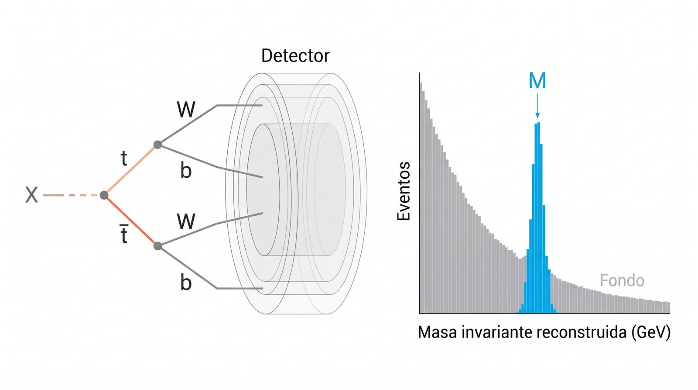
</div>

### Por qué una resonancia que se desintegra en $t\bar{t}$

El **quark top** (≈ 173 GeV) es la partícula elemental más pesada conocida y la que se acopla con más intensidad al bosón de Higgs. Por eso, muchos modelos de **nueva física** predicen resonancias pesadas que se desintegran preferentemente en pares $t\bar{t}$. Esas teorías intentan responder a preguntas que el Modelo Estándar deja abiertas: materia oscura, gravedad, masa de los neutrinos, asimetría materia–antimateria y el problema de la jerarquía.

**El problema práctico:** la teoría no fija la masa de la partícula. Una búsqueda debe ser sensible a **muchas hipótesis de masa a la vez**.

---

## La idea central: redes paramétricas e *inductive bias*

### Dos formas de buscar una partícula de masa desconocida

| | Una red por masa: $f_M(x)$ | Red paramétrica: $f(x, M)$ |
| :--- | :--- | :--- |
| Entradas | 27 variables del evento | 27 variables + la masa hipotética $M$ |
| Entrenamientos | Uno por cada masa simulada | **Uno solo** para todo el rango |
| Masas evaluables | Solo las simuladas | Cualquier valor dentro del rango de entrenamiento |

**Analogía:** el enfoque clásico es como tener **una radio distinta para cada emisora**. La red paramétrica es **una sola radio con un dial**: la masa $M$ es el dial, y girándolo se sintoniza cualquier hipótesis de masa, incluidas las intermedias para las que no se construyó ninguna radio.

### *Inductive bias*

El ***inductive bias*** es el conjunto de **suposiciones** que un algoritmo incorpora para generalizar más allá de sus datos de entrenamiento.

| Modelo | Suposición incorporada |
| :--- | :--- |
| Regresión lineal | La relación entre variables es lineal |
| Red convolucional | Los patrones son locales y pueden aparecer en cualquier posición |
| **Red paramétrica** | **La frontera señal/fondo cambia de forma suave con la masa y comparte estructura entre masas** |

Al introducir $M$ como entrada, **los mismos pesos** procesan todas las masas. Lo que es común (el fondo $t\bar{t}$ y la topología $X \to t\bar{t}$) se aprende una sola vez, y la continuidad de la red respecto a $M$ le permite **interpolar** a masas intermedias.

### Interpolar frente a extrapolar

<div align="center">
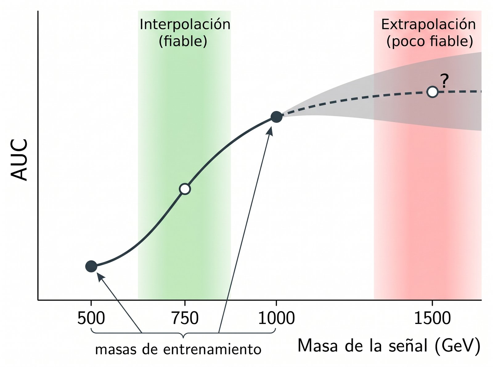
</div>

La red se entrena con 500 y 1000 GeV, y se evalúa en **750 GeV** (interpolación, fiable). Una masa de 1500 GeV sería extrapolación: la red no tendría ninguna referencia de cómo se comporta la frontera fuera del rango.

### El tratamiento de la masa del fondo

El fondo $t\bar{t}$ no contiene ninguna resonancia, así que no tiene masa. Si se le asignara un valor fijo (por ejemplo, 0), la red clasificaría mirando **solo la columna de masa**. Por eso se le asigna una **masa aleatoria** entre las masas de señal: así la columna tiene la misma distribución en ambas clases y la red se ve obligada a aprender la física.

<div align="center">
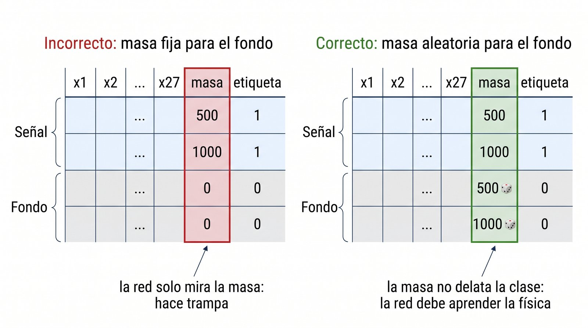
</div>

---

## Datos y diseño experimental

### El dataset HEPMASS

Eventos simulados de colisiones protón-protón del [UCI Machine Learning Repository](http://archive.ics.uci.edu/ml/datasets/hepmass), descritos por **27 variables cinemáticas normalizadas** (22 de bajo nivel y 5 de alto nivel, como $m_{WWbb}$).

### Inspección de los ficheros: solo hay 3 masas

El dataset original contiene señal de 500 a 1500 GeV, pero al inspeccionar **todos** los ficheros proporcionados (incluidos los de tamaño `large`) se comprobó que cada uno contiene **una única masa**:

| Fichero | Masa de la señal | Columna `mass` | Eventos (train / test) |
| :--- | :---: | :---: | :---: |
| `not1000_*_medium` | 500 GeV | Sí | 10,000 / 10,000 |
| `not1000_750_*_medium` | 750 GeV | Sí | 10,000 / 10,000 |
| `1000_*_medium` | 1000 GeV | No | 10,000 / 10,000 |

Todos tienen ~50 % de señal y ~50 % de fondo. Además, la columna `Unnamed: 0` (índice de fila del CSV) se elimina para que no entre como variable.

### Diseño

Con tres masas, el único punto intermedio es **750 GeV**, que se **excluye** del entrenamiento del modelo paramétrico:

| Modelo | Entrenamiento | Entradas | Evaluación |
| :--- | :--- | :--- | :--- |
| $f_{500}$, $f_{750}$, $f_{1000}$ | Señal de **una** masa + fondo | 27 | Test de su propia masa |
| $f(x, M)$ | Señal de **500 y 1000** GeV + fondo | 28 | Test de cada masa, fijando $M$ |

La masa se **estandariza** con los valores del entrenamiento ($\mu = 750$, $\sigma = 250$), de modo que 500 → −1, 750 → 0 y 1000 → +1.

<details>
<summary><b>Inspección visual del dataset (pairplot y matrices de correlación)</b></summary>

<br>

<div align="center">
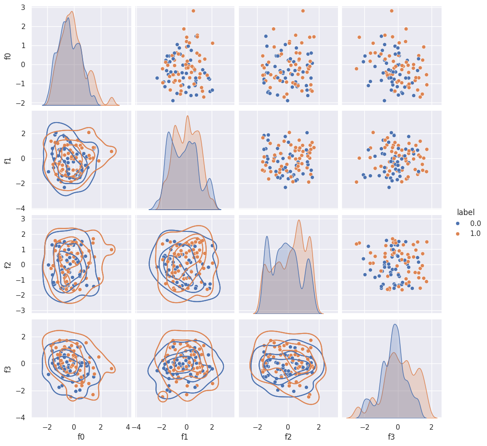
</div>

Las distribuciones de señal (naranja) y fondo (azul) se **solapan casi por completo** en las variables individuales: no se pueden separar con cortes simples, y por eso hace falta una red neuronal que combine las 27 variables.

<div align="center">
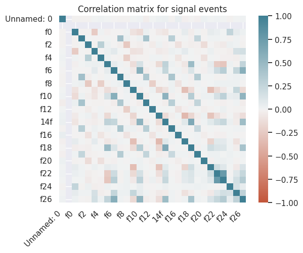

</div>

</details>

---

## Implementación

### Correcciones al template del profesor

| Problema en el template | Consecuencia | Corrección |
| :--- | :--- | :--- |
| `CrossEntropyLoss` con una única salida `Sigmoid` | Pérdida mal definida para clasificación binaria | `BCELoss` |
| Llamada a `train_loop(train_dataloader, ...)` | Función no definida; además duplicaba el entrenamiento en cada época | Eliminada |
| El bucle de test recorre el `dataloader` de entrenamiento | La "pérdida de test" era en realidad pérdida de train | `DataLoader` de test independiente |
| `:` al final de la llamada en *Example of use* | Error de sintaxis | Eliminado |
| Faltan `torch.nn`, `Dataset`, `DataLoader`, `tqdm` | `NameError` | Importados |
| Columna `Unnamed: 0` en los CSV | El índice de fila entraría como variable | Eliminada al cargar |

**Arquitectura** (sin cambios respecto al template): `entradas → 512 → 128 → 64 → 8 → 1`, con `ReLU` en las capas ocultas, `Sigmoid` en la capa de 8 neuronas y en la salida. Unos **89,000 parámetros**.

### Elección del optimizador

| Optimizador | Loss train | Loss test | AUC test (M = 750) |
| :--- | :---: | :---: | :---: |
| SGD (lr = 0.01), el del template | 0.6917 | 0.6916 | 0.7778 |
| **Adam (lr = 0.001)** | 0.3595 | 0.4167 | **0.8920** |

Con SGD la pérdida se queda en $\ln 2 \approx 0.693$, la de un clasificador que responde 0.5 a todo: con 10,000 eventos solo hay ~790 pasos de gradiente en 10 épocas, insuficientes. **Adam** converge y se usa en todos los entrenamientos (10 épocas, lotes de 128, `ExponentialLR` con γ = 0.9).

---

## Resultados

### 1. Modelos de masa fija $f_M(x)$

<div align="center">
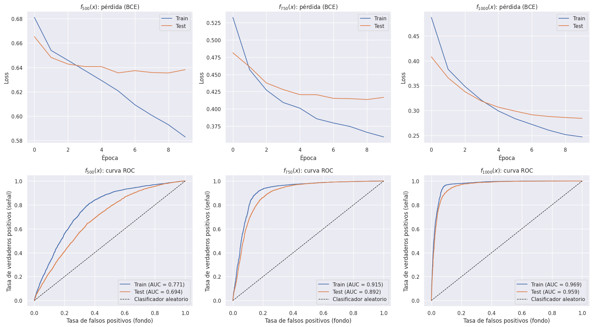
</div>

| Modelo | AUC train | AUC test | Diferencia |
| :--- | :---: | :---: | :---: |
| $f_{500}(x)$ | 0.7708 | 0.6937 | 0.077 |
| $f_{750}(x)$ | 0.9154 | 0.8920 | 0.023 |
| $f_{1000}(x)$ | 0.9690 | 0.9585 | 0.010 |

* **El AUC crece con la masa:** una resonancia más pesada produce productos más energéticos, que se alejan del fondo $t\bar{t}$, concentrado cerca del umbral $2m_t \approx 346$ GeV.
* **El sobreajuste es mayor en la tarea más difícil:** en 500 GeV la pérdida de test se estanca desde la época 3, mientras la de train sigue bajando.

### 2. Modelo paramétrico $f(x, M)$

<div align="center">
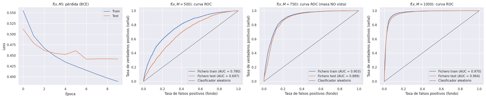
</div>

Una sola red, entrenada con 20,000 eventos (500 y 1000 GeV), evaluada en cada masa fijando la columna $M$. En **750 GeV** (masa no vista), los dos ficheros (train y test) son datos nuevos para la red.

### 3. Gráfica final: AUC en función de la masa

<div align="center">
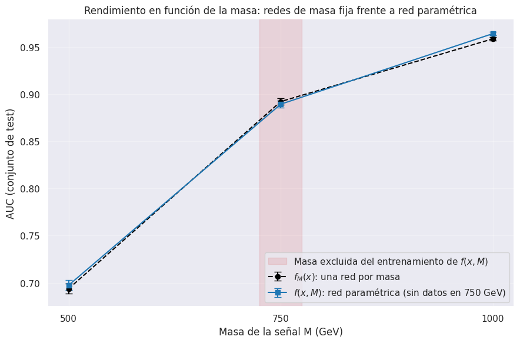
</div>

Barras de error estimadas por ***bootstrap* pareado** (200 remuestreos del conjunto de test):

| Masa (GeV) | $f_M(x)$ | $f(x, M)$ | Diferencia | Diferencia / σ |
| :---: | :---: | :---: | :---: | :---: |
| 500 | 0.6937 ± 0.0052 | 0.6974 ± 0.0052 | +0.0037 | 1.1 |
| 750 | 0.8920 ± 0.0033 | 0.8892 ± 0.0036 | −0.0028 | −1.7 |
| 1000 | 0.9585 ± 0.0021 | 0.9640 ± 0.0019 | +0.0055 | 7.6 |

### 4. La masa excluida frente a otros clasificadores

Sobre el test de **750 GeV**, sin entrenar nada nuevo:

| Clasificador aplicado a la señal de 750 GeV | AUC test |
| :--- | :---: |
| $f_{750}(x)$: especialista entrenado en 750 | 0.8920 |
| **$f(x, M=750)$: paramétrico, sin datos de 750** | **0.8892** |
| $f(x, M=1000)$: paramétrico con el dial en 1000 | 0.8863 |
| $f_{1000}(x)$: especialista de 1000 | 0.8763 |
| $f(x, M=500)$: paramétrico con el dial en 500 | 0.6384 |
| $f_{500}(x)$: especialista de 500 | 0.6355 |

* La red **usa** la entrada $M$: el mejor valor del dial es la masa correcta.
* El dial **no es simétrico**: equivocarse hacia abajo (M = 500) hunde el AUC; hacia arriba (M = 1000) apenas lo reduce.

### 5. Robustez frente a la semilla de entrenamiento

El *bootstrap* solo recoge la fluctuación de la muestra de test, no la del **entrenamiento** (inicialización de los pesos, orden de los lotes, masa aleatoria del fondo). Se repitieron **todos** los entrenamientos con **5 semillas**:

<div align="center">
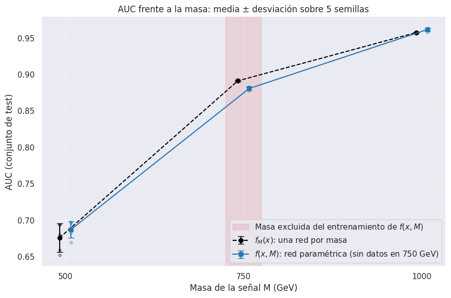
</div>

| Masa (GeV) | $f_M(x)$ | $f(x, M)$ | Diferencia media | Semillas con param > fija |
| :---: | :---: | :---: | :---: | :---: |
| 500 | 0.6759 ± 0.0195 | 0.6873 ± 0.0114 | +0.0114 ± 0.0105 | 4 de 5 |
| **750** | 0.8914 ± 0.0008 | 0.8809 ± 0.0022 | **−0.0105 ± 0.0010** | **0 de 5** |
| 1000 | 0.9576 ± 0.0004 | 0.9618 ± 0.0022 | +0.0042 ± 0.0011 | 5 de 5 |

**Esto cambió una conclusión:** con una sola semilla, la masa excluida parecía un empate (−0.0028). Con 5 semillas, el modelo paramétrico queda **sistemáticamente** un 1 % por debajo del especialista en 750 GeV. La ventaja en 1000 GeV, en cambio, se **confirma**.

---

## Respuestas a las preguntas de la práctica

| Pregunta | Respuesta corta |
| :--- | :--- |
| **8a.** ¿El modelo paramétrico funciona mejor o peor que el entrenamiento detallado para cada masa? | **En rendimiento, equivalente**: todas las diferencias son menores de 0.012, frente a una variación de 0.26 entre masas. **En utilidad, mejor**: un único entrenamiento sustituye a uno por masa y permite barrer todo el rango |
| **¿Y para las masas incluidas en su entrenamiento?** | **Igual** en 500 GeV y **ligeramente mejor** en 1000 GeV (+0.0042, en 5 de 5 semillas). Aprender dos masas a la vez no le penaliza: comparte el fondo y la estructura de la señal, y usa $M$ para adaptarse |
| **¿Y para la masa no incluida (750 GeV)?** | **Ligeramente peor, pero muy cercano**: −0.0105 ± 0.0010 (~1 % del AUC). La red **interpola**, y supera con amplitud al especialista de la masa inferior (+0.25) |

Las respuestas completas y razonadas están en la sección *Respuestas a las preguntas de la práctica* del cuaderno.

---

## Conclusiones

1. **El *inductive bias* importa.** Introducir la masa como entrada no cambia la arquitectura, pero da a la red una estructura que le permite compartir información entre masas e interpolar.
2. **Una red paramétrica sustituye a muchas especializadas** con un rendimiento prácticamente equivalente.
3. **Interpolar no es gratis, pero cuesta poco:** ~1 % del AUC en la masa no vista.
4. **El tratamiento del fondo es clave:** una masa aleatoria impide que la red clasifique mirando solo la columna de masa.
5. **Un solo entrenamiento puede engañar:** para comparar modelos con diferencias de ~0.01 hay que repetir con varias semillas. Aquí, hacerlo cambió la conclusión sobre la masa excluida.

**Limitaciones:** solo hay tres masas disponibles, y por tanto un único punto de interpolación, situado en el centro del rango (el caso más favorable). Se usaron los ficheros `medium` y 10 épocas por limitaciones de tiempo.

---

## Enunciado de la práctica

<details>
<summary><b>Ver las instrucciones originales (en español)</b></summary>

<br>

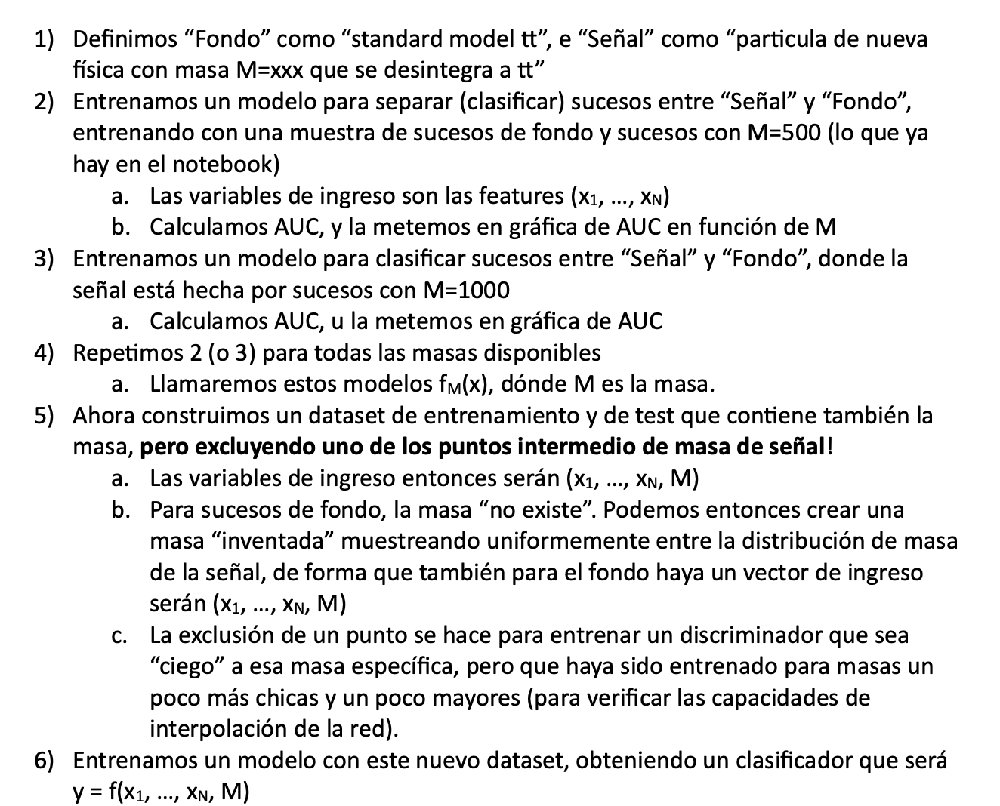
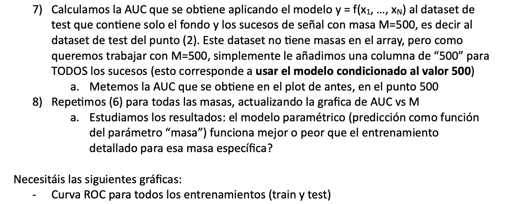
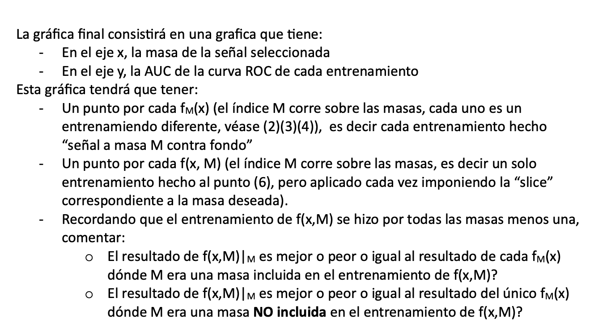

</details>

---

## Cómo ejecutarlo

### Opción 1: Google Colab (recomendada)
1. Haz clic en [](https://colab.research.google.com/github/DanielV-13/ADFM---PL_02_inductive_bias_parameterized_nns.ipynb/blob/main/ADFM_PL_02_inductive_bias_parameterized_nns.ipynb).
2. La primera celda de configuración monta Google Drive y prepara el entorno; acepta el permiso de acceso a Drive.
3. Ejecuta **Entorno de ejecución → Ejecutar todas**. Basta con **CPU**: con entorno CPU y las semillas fijadas, los resultados se reproducen exactamente.

> El cuaderno pesa unos 11 MB porque lleva las imágenes embebidas. Si GitHub no lo previsualiza, ábrelo en Colab o en [nbviewer](https://nbviewer.org/github/DanielV-13/ADFM---PL_02_inductive_bias_parameterized_nns.ipynb/blob/main/ADFM_PL_02_inductive_bias_parameterized_nns.ipynb).

### Opción 2: local
```bash
git clone https://github.com/DanielV-13/ADFM---PL_02_inductive_bias_parameterized_nns.ipynb.git
cd ADFM---PL_02_inductive_bias_parameterized_nns.ipynb
pip install torch pandas numpy matplotlib seaborn scikit-learn scipy tqdm jupyter
jupyter notebook ADFM_PL_02_inductive_bias_parameterized_nns.ipynb
```
Las celdas de Colab (montaje de Drive) deben omitirse en local.

**Datos:** la celda de descarga obtiene `data_for_practica2.zip` del [servidor de la Universidad de Oviedo](https://www.hep.uniovi.es/vischia/adfm/) (o del CERN como alternativa) solo si la carpeta `data_for_practica2/` no existe todavía.

---

## Estructura del repositorio

```
ADFM---PL_02_inductive_bias_parameterized_nns.ipynb/
├── ADFM_PL_02_inductive_bias_parameterized_nns.ipynb   # Cuaderno completo (código, resultados y explicaciones)
├── img/                                               # Gráficos de resultados y figuras de este README
└── README.md                                          # Este archivo
```

---

## Créditos y referencias

| | |
| :--- | :--- |
| **Cuaderno original** | *PL_02: inductive bias and parameterized neural networks* © **Pietro Vischia**, 2025 (Universidad de Oviedo e ICTEA) · [vischia/adfm_2024-2025](https://github.com/vischia/adfm_2024-2025) |
| **Resolución, edición extendida y documentación** | © **Daniel Vaca Velastegui**, 2026 |
| **Asistencia** | **Claude Opus 5.5** (Anthropic) y **Gemini Flash** (Google): explicaciones, revisión y corrección de código, diseño de experimentos, figuras explicativas y revisión de la redacción |
| **Artículo de referencia** | P. Baldi, K. Cranmer, T. Faucett, P. Sadowski y D. Whiteson, *Parameterized Machine Learning for High-Energy Physics*, [arXiv:1601.07913](https://arxiv.org/abs/1601.07913) |
| **Datos** | [HEPMASS](http://archive.ics.uci.edu/ml/datasets/hepmass), UCI Machine Learning Repository |
| **Documentación** | [PyTorch](https://pytorch.org/docs/stable/index.html) · [scikit-learn: ROC y AUC](https://scikit-learn.org/stable/modules/model_evaluation.html#roc-metrics) |

---

<div align="center">

**Daniel Vaca Velastegui** · Estudiante de intercambio en la Universidad de Oviedo · ADFM 2026

*"No se cambia la arquitectura de la red, sino la forma de presentarle el problema."*

</div>
